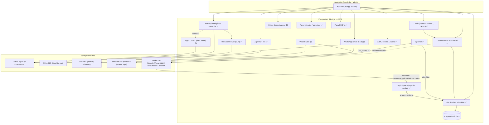
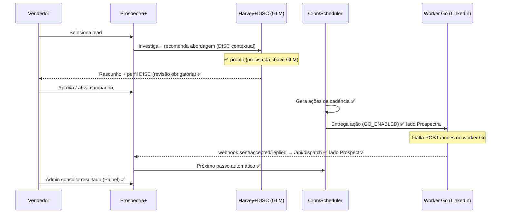

# Prospectra+ — Arquitetura e estado (o que conecta com o quê)

Atualizado em 18/11/2026. Legenda: ✅ pronto e testado · 🟡 pronto mas depende de serviço externo/validação · 🔴 ainda não existe.

## Mapa de módulos e conexões

## Jornada ponta a ponta (estado atual)

## O elo que falta para o automático

- **Lado Prospectra: pronto e testado.** `pushDueActionsToGo` (entrega) + `/api/dispatch` (recebe `sent`/`accepted`/`replied`/`meeting`/`checkpoint`).
- **Lado worker Go: a construir.** Precisa expor `POST /acoes` (ação por-lead) e chamar de volta os eventos. Contrato em `docs/GO-INTEGRACAO.md`.
- **Infra:** VPS no ar + Redis + Playwright; `GO_*`, `DISPATCH_SECRET`, chave GLM e `OFFICE365_*` no `.env`.
